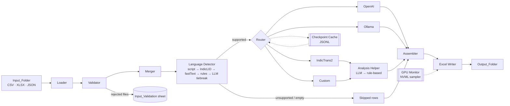

# indic-shloka-translator

Translate shlokas and prose passages from **21 Indian languages into English** on Google Colab — with
language identification that knows *script ≠ language*, Sanskrit sandhi-viccheda and word meanings,
token accounting from the provider (never estimated), GPU telemetry, resumable checkpoints and a
six-sheet Excel output.

---

## Contents
1. [Features](#features) · 2. [Quick start on Colab](#quick-start-on-colab) · 3. [Supported languages](#supported-languages) ·
4. [Models](#models) · 5. [Architecture](#architecture) · 6. [Input files](#input-files) ·
7. [Output workbook](#output-workbook) · 8. [GPU metrics methodology](#gpu-metrics-methodology) ·
9. [Custom model training](#custom-model-training) · 10. [Configuration reference](#configuration-reference) ·
11. [OpenAI cost notes](#openai-cost-notes) · 12. [Troubleshooting](#troubleshooting) · 13. [Repository tree](#repository-tree) ·
14. [Security](#security) · 15. [Testing](#testing) · 16. [Known limitations](#known-limitations)

---

## Features
* **One notebook, one dropdown.** Pick a model (grouped by provider, each with a ✓/⚠ availability badge) or
  `★ ALL MODELS`, click **Run**, get `Output_Folder/<model>_<YYYY-MM-DD>_<HH-MM-SS>.xlsx` (Asia/Kolkata time).
* **Strict input validation** of CSV / XLSX (every sheet) / JSON / JSONL against `ID, Source, Verse, Shloka`;
  bad files are rejected with the exact column diff and the rest still run. `Verse` is always text
  (`1.10` never becomes `1.1`).
* **Tiered language detection:** Unicode script profile → AI4Bharat IndicLID → fastText NLLB LID →
  shloka-specific rules (Sanskrit vs Hindi/Marathi/Nepali/…, Sanskrit written in Bengali/Telugu/Kannada/…/IAST,
  Sindhi vs Kashmiri vs Urdu) → optional LLM tiebreaker. Unsupported languages are `Skipped` with a reason.
* **Four backend families:** OpenAI (structured outputs, parameter-capability adaptation for GPT-5-family
  models), Ollama (local in the Colab VM), IndicTrans2 (gated HF model, batched on GPU) and your own
  fine-tuned `custom-shloka-mt`.
* **Linguistic analysis:** full sandhi-viccheda for Sanskrit, morpheme/word segmentation for others, and a
  contextual meaning per segment. Seq2seq models get this from an *analysis helper* (LLM → rule-based fallback).
* **Never fails the whole run** for one record; `KeyboardInterrupt` writes a partial workbook.
* **Resumable**: every finished record is appended to a JSONL checkpoint; re-runs don't re-bill.
* **Honest numbers:** tokens only from provider `usage` or the real tokenizer; GPU figures are labelled
  *Measured*, *Derived* (formula given), *Spec lookup* or *N/A* with the reason.
* **Secrets** only via Colab Secrets / env / `getpass`; a logging filter redacts `sk-…` / `hf_…` everywhere.

## Quick start on Colab
1. **Download** this repository as a `.zip`, unzip it, and **upload the folder** `indic-shloka-translator`
   **anywhere** on your Google Drive — the notebooks locate it by its contents, no path is hard-coded
   (optionally paste the folder into `REPO_DIR_OVERRIDE` in cell 2 to skip the search).
2. Open `notebooks/01_translate_shlokas.ipynb` in Colab and choose **Runtime → Change runtime type → GPU**
   (T4 is fine for OpenAI / IndicTrans2 / custom; **L4 or A100** for the 27–32B Ollama models).
3. In the **🔑 Secrets** sidebar add `OPENAI_API_KEY` and/or `HF_TOKEN` and enable *Notebook access*.
   For IndicTrans2 first accept the licence at <https://huggingface.co/ai4bharat/indictrans2-indic-en-1B>.
4. Put your files in `Input_Folder/` (the 215-record `Combined_All_Slokas.xlsx` sample is already there).
5. **Runtime → Run all.** In cell 6 choose a model, optionally set *Max records* = 5 for a smoke test,
   click **Run** and watch the progress bar:
   `63.4% complete | 136/215 | ✓ 130 Success | ⤼ 4 Skipped | ✗ 2 Failed | 3.1 rec/s | ETA 00:00:25`
6. Cell 7 previews the result and downloads the workbook; it is also in `Output_Folder/` on Drive,
   with the run log in `logs/<same name>.log`.

CLI alternative: `python scripts/run_cli.py --model gpt-4.1 [--max-records 5] [--no-resume]`
(`--list-models` prints the dropdown with availability).

## Supported languages
Edit `language_detection.supported_languages` in `config/config.yaml` to change the list — everything else is `Skipped`.

| Language | Internal code(s) | Typical script(s) |
|---|---|---|
| Assamese | asm_Beng | Bengali-Assamese |
| Bengali | ben_Beng | Bengali |
| Bodo | brx_Deva | Devanagari |
| Dogri | doi_Deva | Devanagari |
| Gujarati | guj_Gujr | Gujarati |
| Hindi | hin_Deva | Devanagari |
| Kannada | kan_Knda | Kannada |
| Kashmiri | kas_Arab, kas_Deva | Perso-Arabic, Devanagari |
| Konkani | gom_Deva | Devanagari |
| Maithili | mai_Deva | Devanagari |
| Malayalam | mal_Mlym | Malayalam |
| Manipuri (Meitei) | mni_Beng, mni_Mtei | Bengali, Meetei Mayek |
| Marathi | mar_Deva | Devanagari |
| Nepali | npi_Deva | Devanagari |
| Odia | ory_Orya | Odia |
| Punjabi | pan_Guru | Gurmukhi |
| Sanskrit | san_Deva | Devanagari — also detected in Bengali, Telugu, Kannada, Malayalam, Odia, Gujarati, Tamil/Grantha and IAST |
| Santali | sat_Olck | Ol Chiki |
| Sindhi | snd_Arab, snd_Deva | Perso-Arabic, Devanagari |
| Tamil | tam_Taml | Tamil |
| Telugu | tel_Telu | Telugu |

Urdu, English and every other language → `Skipped`, e.g.
`Unsupported language: English (eng_Latn), confidence 0.97 — skipped`.

## Models
| Dropdown name | Provider | Where it runs | GPU need | Approx. VRAM | Segmentation & meanings |
|---|---|---|---|---|---|
| gpt-5.6-sol, gpt-5.6-terra, gpt-5.1, gpt-5, gpt-4.1, gpt-4o, gpt-5.6-luna, gpt-5-mini, gpt-4.1-mini, gpt-4o-mini | OpenAI | OpenAI servers | none | — | by the model |
| IndicTrans2 (`ai4bharat/indictrans2-indic-en-1B`, gated) | Hugging Face | Colab GPU | T4+ | ~4–5 GB fp16 | analysis helper |
| qwen3:32b | Ollama | Colab VM | L4/A100 | ~20 GB | by the model |
| qwen3:30b | Ollama | Colab VM | L4/A100 | ~19 GB | by the model |
| gemma3:27b | Ollama | Colab VM | L4/A100 | ~17 GB | by the model |
| aya-expanse:32b | Ollama | Colab VM | L4/A100 | ~20 GB | by the model |
| custom-shloka-mt | your fine-tune | Colab GPU | T4+ | ~1–5 GB | analysis helper |

* The OpenAI list is configuration, not an assumption: at start-up the app calls `models.list()` once and
  marks any name your key cannot use as **⚠ not available for this key** (if run anyway, every record is
  `Failed` with `Model not available to this API key`).
* GPT-5-family models reject some parameters (e.g. `temperature`); on an HTTP 400 the backend drops or
  renames the parameter, retries once and remembers that for the rest of the run.
* Ollama is **not** a hosted API: `scripts/setup_ollama.sh` installs Ollama inside the Colab VM, starts
  `ollama serve`, and pulls only the selected model. A VRAM pre-flight warns when a model will spill to CPU.

## Architecture

ASCII fallback:
```
Input_Folder → Loader → Validator → Merger → Language Detector ─┬─(unsupported/empty)──────────────┐
                           │ rejected → Input_Validation        └─(supported)→ Router              │
                                                                     ├─ OpenAI ───────────┐       │
                                                                     ├─ Ollama ───────────┤       │
                                                                     ├─ IndicTrans2 ─┐    │       │
                                                                     └─ Custom ──────┴→ Analysis Helper
                                                                                          ↓       ↓
                                                     Assembler ← ─────────────────────────┴───────┘
                                                         ↓
                                  Excel Writer → Output_Folder/<model>_<date>_<time>.xlsx
  side components:  [GPU Monitor (NVML, 1 s)] → GPU_Metrics sheet    [Checkpoint cache (JSONL)] ↔ Router
```

## Input files
Exactly four columns — `ID`, `Source`, `Verse`, `Shloka` — compared after trimming spaces, case-sensitive,
any order. Missing / extra / renamed / duplicated columns ⇒ the file (or XLSX sheet) is rejected and
listed in `Input_Validation` with `missing=[…] extra=[…]`; other files still process. Empty `ID` rejects the file;
empty `Shloka` just makes that record `Skipped`.

**CSV** (UTF-8/UTF-8-BOM/UTF-16; `,` `;` tab `|` auto-detected)
```csv
ID,Source,Verse,Shloka
1,श्रीमद्भगवद्गीता,2.47,कर्मण्येवाधिकारस्ते मा फलेषु कदाचन ।
```
**XLSX** — every non-empty sheet is validated separately (`file.xlsx::Sheet1`). Format `Verse` as *Text* in Excel.
**JSON** — `[{"ID": "1", "Source": "…", "Verse": "2.47", "Shloka": "…"}]` or `{"records": [ … ]}`; **JSONL** one object per line.

Rejected examples: `ID,Source,Shloka` → `missing=['Verse']`; `ID,Source,Verse,Shloka,Notes` → `extra=['Notes']`;
`{"data": {…}}` → `Unsupported JSON shape`; an empty file → `Empty file`.

Duplicates across files: same `ID` *and* same text → second copy dropped (logged); same `ID`, different text →
both kept, `Remarks` = `Duplicate ID across inputs (<file>)`.

> **Note on the sample workbook.** In `Combined_All_Slokas.xlsx`, 60 `Verse` cells are stored as *numbers*,
> so Excel already turned e.g. Kumārasambhava `1.10` and Sūrya-siddhānta `1.10…1.50` into `1.1…1.5`. That
> cannot be undone by any reader; the app reads `Verse` as text from now on and flags the colliding rows with
> `Possible Verse corruption …` in `Remarks`. Fix the source cells (format as Text) to get exact labels.

## Output workbook
`Output_Folder/<model>_<YYYY-MM-DD>_<HH-MM-SS>.xlsx` (`:` `/` `\` spaces → `-`; never overwritten — `_1`, `_2` are appended).
ALL MODELS also writes `ALL-MODELS_<date>_<time>.xlsx` with `Generated_Meaning` side by side.

**Sheet `Translations`** (one row per input record, in input order)

| Column | Content |
|---|---|
| ID, Source, Verse, Shloka | from the input (Verse as text, Shloka unchanged apart from Unicode NFC) |
| Detected_Language | e.g. `Sanskrit` |
| Generated_Meaning | English translation by the selected model |
| Word_Segmentation | Sanskrit sandhi-viccheda / other segmentation, joined with ` \| ` |
| Word_Meanings | one `word: meaning` per line |
| Input_Tokens, Output_Tokens, Total_Tokens | selected model only (provider usage / tokenizer); 0 when skipped |
| Processing_Status | `Success` (green) / `Skipped` (amber) / `Failed` (red) |
| Remarks | skip/failure reason, `Partial: …`, chunking/transliteration notes, `Analysis by …`, `Note: <translator note>` |

Other sheets: **GPU_Metrics** (20 parameters, below) · **Run_Summary** (model, provider, times, counts incl. cached,
token totals, prompt version, config snapshot without secrets, library versions, GPU, runtime) ·
**Input_Validation** (Accepted/Rejected per file/sheet with reason) · **Detection_Audit** (ID, code, script,
confidence, method, provenance) · **Token_Breakdown** (translation, reasoning, analysis-helper and
LID-tiebreaker tokens, retries, cached flag).

## GPU metrics methodology
A background thread samples NVML (`nvidia-ml-py`) every second **during the translation phase only**.

| # | Parameter | Method |
|---|---|---|
| 1 | GPU utilisation % (avg/peak) | Measured — NVML `utilization.gpu` |
| 2 | VRAM used GB (avg/peak) | Measured — device-wide |
| 3 | Total VRAM | Measured |
| 4–5 | Core / memory clock MHz | Measured (avg + max) |
| 6 | Memory bandwidth GB/s | Derived: max memory clock × 2 (DDR) × bus width ÷ 8, cross-checked with the spec table |
| 7 | CUDA cores | NVML `nvmlDeviceGetNumGpuCores` if supported, else spec lookup |
| 8–11 | Tensor cores, FP32, FP16/BF16 (dense), INT8 (dense) | Spec lookup (NVIDIA datasheets, cited in `gpu_specs.py`) |
| 12 | Batch size | From config/run |
| 13 | Throughput (rec/s, output tok/s) | Measured over the run |
| 14 | Latency mean/p50/p95 | Measured per record (batched seq2seq: batch time ÷ batch size) |
| 15 | PCIe TX/RX | Measured NVML counters + theoretical max (gen × width) |
| 16 | Power W (avg/peak) + energy Wh | Measured; energy = ∫P dt |
| 17 | Temperature °C | Measured |
| 18 | Energy efficiency (tok/s per W, tokens/J) | Derived |
| 19 | Memory read/write throughput | Derived (approx.): memory-controller busy % × theoretical bandwidth |
| 20 | SM utilisation | NVML per-process SM util if exposed, else DCGM if installed, else `N/A — not exposed on Colab` + proxy |

Spec table covers T4, L4, A100 40/80 GB, V100, H100 (SXM/PCIe) and RTX PRO 6000 Blackwell (Colab "G4");
unknown GPUs show `N/A — GPU not in spec table`. OpenAI runs still get the sheet with the note
*"Translation inference ran on OpenAI servers; local GPU figures reflect only local work."* No GPU → one row `No GPU detected`.

## Custom model training
`notebooks/02_train_custom_model.ipynb` (needs `HF_TOKEN`; base checkpoints and BPCC are gated):
1. Data: `rahular/itihasa` (~93k Sanskrit–English pairs, Apache-2.0), `ai4bharat/BPCC` (up to 20,000
   human-annotated pairs per language, discovered at run time; skipped if inaccessible), any datasets you add
   under `training.extra_hf_datasets`, and your files in `Training_Data/` (`Source_Text, Language, English`).
2. Cleaning: NFC, de-duplication, length-ratio filter, > 512-token pairs dropped. **Leakage guard** removes
   pairs matching (exactly or ≥ 0.9 character similarity) any shloka in `reference/` or `Input_Folder/`.
3. 95 / 2.5 / 2.5 split stratified by language; `Seq2SeqTrainer` (lr 3e-5, warmup 500, label smoothing 0.1,
   effective batch 64, fp16/bf16 by GPU, early stopping on validation chrF++); checkpoints in
   `training.checkpoint_dir` (default `models/checkpoints` inside the repo, i.e. on Drive) every `save_steps`, automatic resume.
4. Export to `models/custom/custom-shloka-mt_<date>_<time>/` with `model_card.md`, `metrics.json`
   (BLEU/chrF++ base vs fine-tuned per language), `training_config.yaml`, `data_manifest.csv`.

T4: `indictrans2-indic-en-dist-200M` full fine-tune. L4/A100: `indictrans2-indic-en-1B` + LoRA (merged on export).
`QUICK_RUN=True` trains a few hundred steps on a 3k-pair subset to check the setup end to end.

## Configuration reference
All settings live in `config/config.yaml` (validated by pydantic; unknown keys are errors).

| Section | Key settings |
|---|---|
| `paths` | input/output/log/cache/custom-model folders (relative to the repo) |
| `schema` | `expected_columns`, `allow_extra_columns: false` |
| `runtime` | `timezone`, `device`, `allow_cpu_fallback`, `resume_from_checkpoint`, `max_records`, `prompt_version` (cache key) |
| `language_detection` | `min_confidence`, `use_llm_tiebreaker`, `tiebreaker_model`, `use_indiclid`, `use_fasttext_fallback`, `supported_languages` |
| `concurrency` | `openai_max_workers`, `ollama_max_workers`, `hf_batch_size`, `max_retries`, `request_timeout_s`, `openai_requests_per_minute` |
| `generation` | `temperature`, `seed`, `max_output_tokens`, beams/max length for seq2seq, `ollama_num_ctx` |
| `openai` | `use_responses_api` (Chat Completions by default) |
| `analysis` | `helper_model`, `helper_fallback_order` (`rule_based` = sanskrit_parser / indic-nlp) |
| `gpu_monitor` | `sample_interval_s`, `memory_data_rate_factor` |
| `training` | base model, LoRA, data caps, hyper-parameters, `checkpoint_dir` (relative to the repo) |
| `models` | the dropdown registry, in order |

Prompts are plain text in `config/prompts/` (`translate_system.txt`, `translate_user.txt`, `analysis_only.txt`).
Change `runtime.prompt_version` whenever you edit them so cached results are not reused.

## OpenAI cost notes
Each record costs one structured-output call (≈ 700–900 prompt tokens for the system prompt + verse, and a few
hundred to ~2,000 output tokens because segmentation and meanings are included); an invalid-JSON retry or a
`max_output_tokens` retry adds a second call. GPT-5-family models also bill **reasoning tokens** (shown in
`Token_Breakdown`). The analysis helper (for IndicTrans2/custom) and the LID tiebreaker add small calls,
reported separately. Multiply the token totals in `Run_Summary` by your model's current per-token prices
(see OpenAI's pricing page) — the app does not hard-code prices. Use *Max records = 5* first; checkpoints
prevent paying twice for finished records.

## Troubleshooting
| Symptom | Fix |
|---|---|
| `⬇ qwen3:32b — not set up yet…` (or `ollama package not installed`) | Normal on a fresh Colab runtime: Ollama models run **inside the VM**, so the `ollama` client, the Ollama server and the 17–20 GB model weights are only installed when needed. Click **Run** (or **Set up Ollama for selection**) — it installs and downloads everything; use an L4/A100 for 27–32B models. |
| `IndicTransToolkit not installed` / `transformers not installed` | A plain `pip install -r` installs **nothing** if one package fails to build. Re-run cell 3 — `scripts/install_requirements.py` installs package by package (with fallbacks, e.g. IndicTransToolkit from GitHub) and prints a ✓/✗ line per package. **Run** also retries IndicTransToolkit automatically. Then click **Refresh availability**. |
| `⚠ … Ollama server not running` / `not pulled yet` | Expected before setup: Ollama models are downloaded into the Colab VM on demand. Select the model and click **Set up Ollama for selection** (or **Run**). Use an L4/A100 runtime for 27–32B models. |
| `⚠ IndicTrans2 — No access … accept the licence` | Log in on Hugging Face, open the model page, accept the terms, make sure `HF_TOKEN` is the same account, re-run cell 4. |
| Ollama model very slow / out of memory on T4 | 27–32B models need ~17–20 GB plus context; on a 16 GB T4 they spill to CPU. Switch to L4/A100 or use an OpenAI model. |
| Colab disconnected mid-run | Re-run cells 1–6 with *Resume from checkpoint* ticked; finished records are loaded from `Output_Folder/.cache/<model>/<prompt_version>.jsonl` and not re-billed. |
| Many `RateLimitError` retries | Lower *Concurrency* or `openai_requests_per_minute`; the backend already honours `Retry-After`. |
| `Model not available to this API key` | The name isn't in your key's `models.list()`; pick another model or edit the registry. |
| `No GPU detected — local models are blocked` | Switch the runtime to GPU, or set `runtime.allow_cpu_fallback: true` (slow). |
| `No input file passed validation` | Check `Input_Validation` / the log for the column diff of each file. |
| Training: `Dataset scripts are no longer supported, but found itihasa.py` | `datasets` ≥ 4.0 dropped loading scripts. Fixed in v1.3: the loader falls back to the Hub's auto-converted Parquet files (`refs/convert/parquet`, then the Parquet API). |
| `Custom model not trained yet` | Run `notebooks/02_train_custom_model.ipynb`. |
| IndicLID download failed | Detection continues with fastText + rules (+ LLM tiebreaker); the method used is in `Detection_Audit`. |

## Repository tree
```
indic-shloka-translator/
├── README.md  requirements.txt  requirements-train.txt  .env.example  .gitignore  LICENSE  ruff.toml
├── config/config.yaml, config/prompts/{translate_system,translate_user,analysis_only}.txt
├── reference/Combined_All_Slokas.xlsx
├── Input_Folder/ (README.md + sample)   Output_Folder/   Training_Data/   models/custom/   logs/
├── notebooks/01_translate_shlokas.ipynb, 02_train_custom_model.ipynb
├── scripts/setup_ollama.sh, run_cli.py
├── shloka_translator/
│   ├── config.py  secrets.py
│   ├── io/{loader,validator,merger}.py
│   ├── langid/{script_detector,detector,languages}.py
│   ├── models/{base,registry,openai_backend,ollama_backend,indictrans2_backend,custom_backend}.py
│   ├── analysis/{segmentation,word_meanings}.py
│   ├── prompting/{templates,schemas}.py
│   ├── pipeline/{orchestrator,executor,checkpoint,progress}.py
│   ├── monitoring/{gpu_monitor,gpu_specs}.py
│   ├── output/{naming,excel_writer}.py
│   ├── training/{data_prep,train,evaluate}.py
│   ├── ui/widgets.py
│   └── utils/{text,timing}.py
└── tests/ (fixtures + test_validator, test_merger, test_langid, test_naming, test_excel_writer,
           test_pipeline_smoke, test_backends, test_repo_quality)
```

## Security
* Keys are read from Colab Secrets → environment → `getpass`, never from files in the repo, and never printed.
* A logging filter masks `sk-[A-Za-z0-9_-]{10,}`, `hf_[A-Za-z0-9]{10,}` and any loaded secret value in every
  log line; `Run_Summary` stores a config snapshot that by design contains no secrets.
* `.env` is git-ignored; `.env.example` ships empty. `tests/test_repo_quality.py` fails if a token pattern
  appears anywhere in the repository; `tests/test_pipeline_smoke.py` checks outputs, logs and checkpoints.

## Testing
```bash
pip install -r requirements.txt
pytest -q          # offline: mock backends, no network, no GPU
ruff check .
```

## Known limitations
* The rule-based detection tier is tuned for verse and short prose; the bundled mixed-language fixture
  sentences for the smaller languages (Bodo, Dogri, Konkani, Maithili, Kashmiri, Sindhi, Santali, Manipuri)
  were written for testing and should be checked by native speakers. IndicLID (installed in cell 3) is the
  primary classifier in Colab.
* `sanskrit_parser` sandhi splitting (rule-based fallback) is slow and imperfect; LLM helpers give better
  segmentation.
* Per-process SM utilisation is usually not exposed on Colab; the sheet says so and shows a proxy.
* Model names in the registry are configuration; whether each exists for your key is checked at run time.
